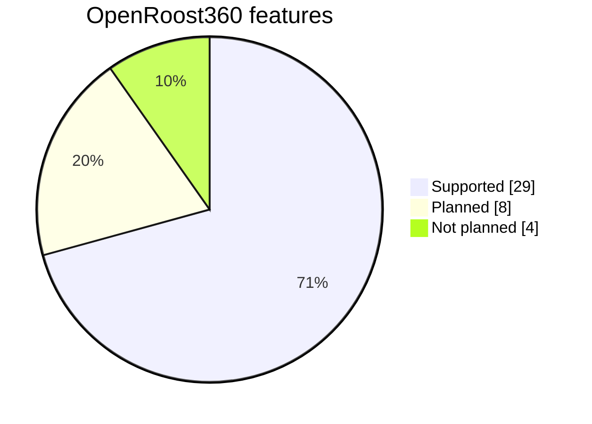

# OpenRoost360

**Keep a Roost Security360 alarm working after Roost shut its cloud down.**

Roost was acquired in 2026 and its Security360 cloud, apps and monitoring were switched off. The SmartBase hub,
keypad and sensors still work, but the hub only talks to that cloud, so nobody hears about alarms anymore.
OpenRoost360 is a small server you run at home that answers the hub in the cloud's place. Your kit comes back to
life on your own network: live status, alarms and notifications, a web dashboard, and an API for a phone app.

Not affiliated with Roost. Built from the protocol notes in [PROTOCOL.md](PROTOCOL.md).

## How it works

```
 SmartBase ──DNS──▶ Pi-hole: "Roost cloud" = this server
     │
     └──TLS :443 ──▶ (iptables) ──▶ OpenRoost listener :8883 ──▶ hub state ──▶ dashboard / API / alerts
                                       time reply + MQTT                        email · Matrix · ntfy · webhooks
```

1. **DNS.** The hub looks up Roost's two cloud names. A Pi-hole answers them with this server's address
   (`misc.dnsmasq_lines`: `address=/us-central1-mqtt.clearblade.com/<server>` and the same for
   `us-central1-roostprod.cloudfunctions.net`).
2. **Port redirect.** The hub connects to port 443; an iptables rule sends just the hub's traffic to the listener.
3. **Listener.** Answers the hub's time request and speaks enough MQTT to keep it connected. The hub doesn't check
   certificates, so a self-signed one works. Only the hub you claim during setup may connect.
4. **Everything else.** What the hub reports becomes status, history, alarms and notifications.

## Feature support



✅ **Supported**: works today · 🟡 **Planned**: greyed out in the app and answers `501 Planned, unsupported` in the
API, so the app picks it up as soon as it's built · ⛔ **Not planned**: outside what a local server can do, or not on
the roadmap

| Area | Feature | Status | Notes |
|---|---|:-:|---|
| **Hub** | Live status: mains power, backup battery, Wi-Fi, cellular, temperature, firmware | ✅ | |
| | Event history with the raw hub messages | ✅ | |
| | Arm state with exit and entry countdowns | ✅ | Read-only: arm and disarm at the keypad |
| | Arming and disarming from the app | 🟡 | Needs the hub's command format |
| | Keypad PINs (owner, guest, hostage) | 🟡 | Needs the hub's settings (`/config`) format |
| | Entry and exit delays, door chime | 🟡 | Same |
| | Wi-Fi setup for a new or reset hub | 🟡 | Soft-AP protocol decoded; not wired up yet |
| **Sensors** | Battery, signal, firmware, Missing | ✅ | |
| | Names and rooms, removing old sensors from the list | ✅ | |
| | Pairing new sensors (gray button on the hub) | ✅ | Pairing itself is local to the hub |
| | Per-sensor alert modes | 🟡 | Needs `/config` |
| | Unpairing a sensor from the hub | 🟡 | Needs the command format |
| **Alarms** | Intrusion, fire, panic, hostage PIN (silent), water leak | ✅ | Acknowledged in the app; repeat until then |
| | Emergency countdown: break-in, fire and distress PIN warn the household first; reply "N", the email link or the app cancels before contacts are told; a follow-up says who was told | ✅ | Per-alarm on/off and seconds; you choose who is warned and can cancel |
| | Climate, low battery, missing sensor, hub offline | ✅ | |
| | Professional 24/7 monitoring and emergency dispatch | ⛔ | That was Roost's paid service; OpenRoost alerts you and your contacts |
| | Alerts over the hub's cellular backup when the internet is down | ⛔ | Cellular goes to Roost's cloud through the carrier, out of reach of your Pi-hole |
| **Notifications** | Email with branded HTML, test button | ✅ | Your relay, an email account, or OpenRoost's relay |
| | Matrix / Element: household room and DMs to emergency contacts, test button | ✅ | |
| | ntfy push, signed webhooks | ✅ | |
| | Contacts with alert tiers, routing per alarm type, quiet hours | ✅ | |
| | Matrix end-to-end encryption: encrypted rooms detected automatically, encrypted DMs, cross-signed bot device | ✅ | Olm/Megolm by vodozemac (Matrix.org's library) |
| | SMS and phone calls | ⛔ | Use ntfy, Matrix or a webhook to your own SMS gateway |
| **Network** | Use your Pi-hole (checks it, gives you the `misc.dnsmasq_lines`) | ✅ | Pi-hole v6 doesn't let apps set them |
| | OpenRoost's own Pi-hole (`pihole` profile), DNS lines added automatically | ✅ | |
| | Your mail relay, or OpenRoost's own Postfix relay (`mailrelay` profile) | ✅ | |
| | Redirect health checks and one-click fixes; hub port rule kept across reboots | ✅ | |
| **Accounts** | Owner / member / viewer roles, household members | ✅ | |
| | Two-factor codes, Authentik sign-in, reverse-proxy header sign-in | ✅ | |
| | Password reset by email, "password changed" notices | ✅ | |
| | Invite links: single use, expiring, by email or copied | ✅ | |
| **Server** | HTTPS with certificate pinning, encrypted secrets, rate limits | ✅ | |
| | Audit log, encrypted backups and restore | ✅ | |
| | Update notices from release tags, `./update.sh` | ✅ | |
| | Master-key rotation: re-encrypts every secret, signs everyone out | ✅ | Crash-safe; passwords keep working |
| **Apps** | Web dashboard (desktop and phone) and setup wizard | ✅ | |
| | API for a phone app, with planned endpoints already in place | ✅ | [docs/API.md](docs/API.md) |
| | Android app | 🟡 | After the protocol is complete |
| | Wall-tablet mode | 🟡 | Needs arming from the app |
| | The original Roost app, or Alexa / Google Assistant | ⛔ | Tied to Roost's accounts and cloud |
| **Research** | Live protocol log of everything the hub sends and receives | ✅ | Below |

Every planned hub feature waits on one thing: the format the cloud used to send commands and settings **to** the hub.
Everything the hub reports is already understood (see [PROTOCOL.md](PROTOCOL.md)).

### Protocol log (for reverse-engineering)

The listener records every connection, TLS handshake, time request, MQTT packet and payload, both directions. Three
ways to watch it:

- **Dashboard:** Activity → **Live protocol log** (owners only): live, filterable, searchable, click an entry for all
  of it, download as JSONL.
- **Terminal:** `OPENROOST_WIRE_STDOUT=1` in `.env`, then `docker compose logs -f openroost | grep wire`.
- **File:** Settings → System → Protocol log → *Also save it to a file*, then `sudo tail -f data/wire.jsonl`
  (rotates at 20 MB). Or from code: `GET /api/v1/debug/wire` and `wire` events on `/api/v1/stream`.

It contains your hub's ID, SIM number and Wi-Fi name: redact before sharing.

## Install

See **[INSTALL.md](INSTALL.md)**. In short:

```bash
git clone https://git.tysstech.com/TySS-Dev/OpenRoost360.git && cd OpenRoost360
cp .env.example .env
docker compose up -d --build
docker compose logs openroost        # the first-time setup code
```

Then open `https://<server>:8443/` and follow the setup wizard.

## Updates

Releases are git tags `vX.Y.Z`. The server checks for new ones twice a day and shows owners **Update available**;
`./update.sh` installs the newest release. Details in [INSTALL.md](INSTALL.md#updating).

## API and the phone app

The dashboard and the planned phone app use the same API: HTTPS, an account on the server, live updates over
server-sent events. See **[docs/API.md](docs/API.md)**; the full route list is at `/api/v1/openapi.json`.

## Security

- HTTPS by default (TLS 1.2+), own certificate or yours; the app pins the certificate fingerprint.
- Passwords: Argon2id with a server-side pepper. Secrets (Pi-hole and mail passwords, API keys, Matrix token,
  webhook/SSO secrets) encrypted with AES-256-GCM. Master key outside the database.
- Sessions: HttpOnly SameSite=Strict cookies, revocable app tokens, roles checked on every request, sign-in and
  reset throttling, CSRF and DNS-rebinding guards, strict Content-Security-Policy, rate limits.
- Docker: only the `NET_ADMIN` capability (for the port rule), read-only filesystem, `no-new-privileges`.
- `tests/test_security.py` runs 206 checks against a live server (sign-in, roles, secrets at rest, HTTPS,
  listener, password reset, injection, traversal…).

## Project layout

| Path | What |
|---|---|
| `openroost/` | The server: listener, hub engine, notifications, services, accounts, storage, API |
| `web/` | Dashboard and setup wizard |
| `tests/` | Security and alert-path tests, plus test-only stand-ins for the hub, Pi-hole, a mail server and Matrix |
| `docs/API.md` | API guide for the phone app |
| `Dockerfile`, `compose.yaml`, `.env.example`, `update.sh` | Docker install and updates |
| `run.sh` | Run without Docker |
| `PROTOCOL.md` | Everything known about the hub's protocol |
| `roost_listen.py`, `roostfiles-certs/` | Protocol research tool and archived cloud files (not used by the app) |

## Development

```bash
pip install -r requirements.txt
./run.sh fg                          # https://localhost:8443/
python3 tests/test_security.py       # ~2 minutes
python3 tests/test_notify.py         # ~6 minutes: hub alarm -> email + Matrix, repeats, encryption, emergency countdown
                                     # (the encryption and countdown parts need `pip install vodozemac`; skipped otherwise)
python3 tests/fakehub.py --port 8883 # a stand-in hub that connects to the listener and reports a few sensors
```

To release: bump `__version__` in `openroost/__init__.py`, commit, `git tag vX.Y.Z`, push the tag.

## License

See [LICENSE](LICENSE).
